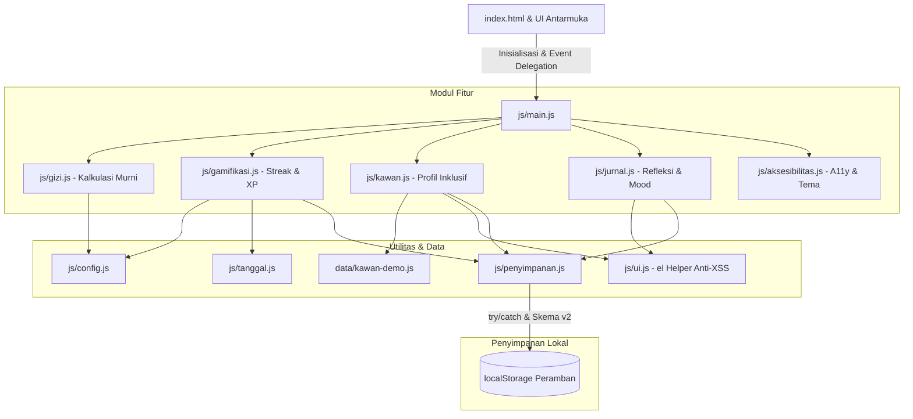
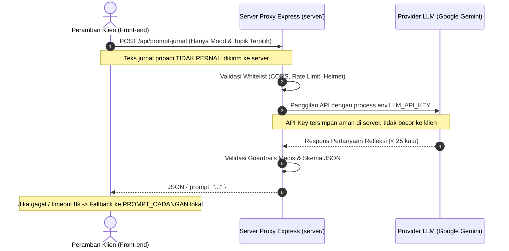

# Dokumentasi Arsitektur Sistem GERAK

Dokumen ini menjelaskan rancangan arsitektur perangkat lunak GERAK (Gizi, Energi, Raga, Kawan) untuk kompetisi LOGICODIX 2026 kategori *Inclusive Health & Well-being*.

---

## 1. Prinsip Desain Arsitektur

1. **Zero-Dependency Frontend**: Dibangun murni menggunakan Web Standards modern (Vanilla HTML5, CSS3, dan ES Modules) tanpa framework berat (React/Vue) atau CSS utility engine (Tailwind). Hal ini meminimalkan ukuran bundle, jejak karbon (*Green IT*), dan kerentanan supply-chain pihak ketiga.
2. **Client-Side Privacy by Default**: Data sensitif pengguna (riwayat jurnal harian, log mood, catatan berat badan, dan aktivitas perawatan diri) disimpan secara lokal di peramban pengguna melalui `localStorage`. Tidak ada database pengguna di awan dan tidak ada pelacak (*trackers*).
3. **Defense-in-Depth Security**: Menghilangkan seluruh injeksi HTML dinamis (`innerHTML`), melarang inline event handler (`onclick`), dan menerapkan validasi input ketat baik di sisi antarmuka maupun logika bisnis murni.
4. **Resilient Data Storage**: Seluruh interaksi `localStorage` diproteksi blok `try/catch` dengan mekanisme migrasi skema versi dan pembatasan kapasitas memori.

---

## 2. Diagram Aliran Data Front-End

Diagram berikut memvisualisasikan arsitektur modular sisi klien:

---

## 3. Diagram Arsitektur Integrasi AI & Alasan Penggunaan Proxy

Untuk fitur AI di masa mendatang (Fase 4), GERAK tidak pernah menghubungkan peramban langsung ke penyedia LLM (seperti Google Gemini API). Aliran wajib melalui **Proxy Backend Ringan**:

### Mengapa Membutuhkan Proxy?
1. **Perlindungan Kredensial**: Kunci API (*API Key*) tidak boleh berada di kode klien peramban atau repository publik.
2. **Perlindungan Privasi**: Server proxy membatasi payload hanya pada kategori (misal: mood `🙂`, topik `tidur`). Teks curahan hati pengguna tetap berada 100% di perangkat klien.
3. **Filter Keamanan & Guardrails**: Mencegah model AI memberikan anjuran medis, diagnosis mandiri, atau angka defisit kalori ekstrem.